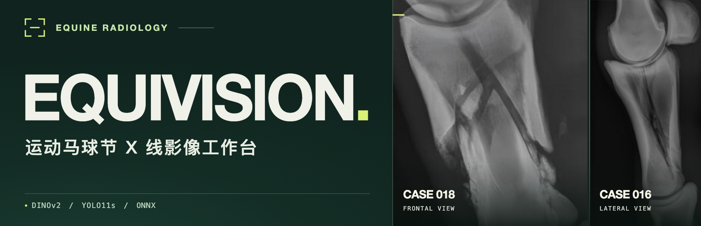
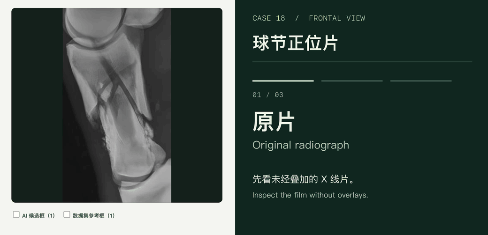

<h1><a href="https://elfaw775.github.io/sport-model/#new"></a></h1>

<a href="https://elfaw775.github.io/sport-model/#new"></a> <a href="https://elfaw775.github.io/sport-model/static/examples.html"></a>

[简体中文](README.md)

Take a sport horse fetlock radiograph from upload to signed review. **DINOv2** screens the primary film, **YOLO11s** marks candidate regions, and the reviewer checks the image and can add annotations before signing. Both models run in the browser.

**Run a case** Sign in with `wangyiyi` / `wangyiyisportsHorse`. Choose **film 16**, confirm the projection and image quality, then click **用此样片新建检查** and **开始分析**. This lateral view produces two candidate boxes. The first run downloads about 141 MB of weights and runtime.

## Read a film, one layer at a time

**Case 18 · Frontal fetlock view** Switch between the original radiograph, the model's candidate box and the dataset annotation. Click the image to try the layers yourself without signing in.

<a href="https://elfaw775.github.io/sport-model/static/examples.html#18">
  <picture>
    <source media="(prefers-reduced-motion: reduce)" srcset="docs/images/case-report-18.png">
    
  </picture>
</a>

[Open case 18](https://elfaw775.github.io/sport-model/static/examples.html#18) · [View the still image](docs/images/case-report-18.png) · [Compare with case 75](https://elfaw775.github.io/sport-model/static/examples.html#75)

**Why open case 75?** DINOv2 flags the film for review, while YOLO returns zero boxes. Switch on the reference layer to see two annotated lesions. The reviewer can inspect the original even when the detector has no location to suggest.

## How did the models perform?

| Whole-film screening · DINOv2 | False boxes · YOLO11s | Lesions located · YOLO11s |
| --- | --- | --- |
| **82 / 84 films correct** | **9 → 5 false boxes** | **3 / 12 lesions** |
| Five-fold evaluation missed 2 of 68 positive films and correctly classified all 16 negatives. | Retraining cut false boxes by 44.4% on the same 12 holdout films. | Both versions located three lesions. Box precision rose from 25.0% to 37.5%. |

Both detectors were scored at a 0.15 confidence threshold and IoU ≥ 0.50. Image height alone classified **81 of 84 films** correctly. Performance on new horses and devices still needs independent validation. [Per-film results](image-study/published/cv84/three-model-oof.csv) · [Localization experiment](training/results/comparison-2026-11-18/README.md)

<details>
<summary><strong>Model methods, thresholds and evaluation</strong></summary>

| Component | Input and output |
| --- | --- |
| **DINOv2 Small · whole-film screening** | A frozen visual encoder and a fitted classifier score the primary radiograph on a 336 × 336 canvas. A score at or above the operating threshold flags the image for review. |
| **YOLO11s · localization** | The detector runs at 640 × 640 and returns box coordinates and scores. During retraining, 66 rotated annotations were converted to enclosing rectangles using their recorded angles. The deployed box threshold is 0.20. |

Each case keeps both model versions, thresholds and outputs alongside the review. The same ONNX weights run in the browser on GitHub Pages and on CPU in the Python service. [Screening model and preprocessing](backend/models/dinov2-fetlock-84.json) · [Detection code](backend/detector.py) · [Label conversion and training](training/README.md)

- **Screening on 84 project films.** In a matched five-fold study of 68 positive and 16 negative films, DINOv2 correctly classified **82/84**, missing **2/68** positives and flagging **0/16** negatives. The earlier YOLO11s training recipe missed 15 positives and the retrained recipe missed 20. Each film was scored once while held out. The deployed DINO classifier was subsequently fitted on all 84 films. [Per-film predictions](image-study/published/cv84/three-model-oof.csv) · [Study and reproduction guide](image-study/README.md)
- **Localization on 12 historical holdout films.** At the same box threshold of 0.15 and a matching IoU of at least 0.50, retraining YOLO11s reduced false boxes from **9 to 5**. Both versions located **3 of 12 annotated lesions**. Box precision therefore rose from **25.0% to 37.5%**, while nine lesions remained unlocated. [Detector comparison](training/results/comparison-2026-11-18/README.md)
- **Limits.** Image height alone correctly classified **81/84** films, and changing the input padding changed some screening decisions. The practice films come from this development collection. Performance on new horses and independently acquired images still requires validation. A qualified reviewer makes the final assessment. [Padding experiments](image-study/published/cv84/canvas-round2/README.md#english)

</details>

## Use and development

<details>
<summary><strong>Case workflow, annotations and exports</strong></summary>

1. **Sign in.** In the Chinese-language workbench, select `wangyiyi` and enter `wangyiyisportsHorse` (capital **H**). The other demo accounts are `zhushijia`, `alimire` and `liqihang`, each with its username followed by `sportsHorse` as its password.
2. **Choose a radiograph.** The new examination page offers practice films **16, 23, 56 and 8**. Select a thumbnail, check the projection and confirm image quality, then click **用此样片新建检查** to create a numbered case. You can also draw from the 84-film library or upload a PNG, JPEG or WebP. The first image is the primary view. Additional views can be compared side by side.
3. **Run the analysis.** Check the primary image and run both models. Start with **16** for a film with two candidate boxes. Then try **23** for a positive whole-film screen with no boxes. The first browser run downloads about **141 MB** of weights and runtime. **提前准备模型** preloads them before a presentation.
4. **Review and archive.** Inspect the original, measure distances or angles, and optionally add a rectangle or four-point region. Sign the report, then archive the case. A blank review requires a second confirmation. Search the case history by its EV number to reopen the signed report.

The viewer can export an offline printable report. For a reviewed image with both AI and manual regions, download a combined, AI-only or manual-only overlay as a PNG or as a CVAT COCO 1.0 dataset with the source image and annotations.

</details>

<details>
<summary><strong>Run locally and share cases · Python 3.12</strong></summary>

The public demo stores uploads, edits and history in **IndexedDB** in the current browser profile. Its four demo accounts share that browser's records. Other devices can open the two published example reports. To share newly created cases across devices, run the Python service on a reachable host with persistent storage. It stores original image bytes, predictions, annotations and reports in **SQLite**, at `var/cases.sqlite3` by default.

Clone the repository and enter its directory.

```sh
git clone https://github.com/elfaw775/sport-model.git
cd sport-model
```

**macOS or Linux, Python 3.12**

```sh
python3.12 -m venv .venv
.venv/bin/python -m pip install -r backend/requirements.txt
.venv/bin/python -m uvicorn backend.app:app --host 127.0.0.1 --port 8765
```

**Windows, PowerShell and Python 3.12**

```powershell
py -3.12 -m venv .venv
.\.venv\Scripts\python.exe -m pip install -r backend/requirements.txt
.\.venv\Scripts\python.exe -m uvicorn backend.app:app --host 127.0.0.1 --port 8765
```

[Open the local workbench](http://127.0.0.1:8765/#new) and use the same demo credentials. The commands bind to loopback for local use. For a hosted service, configure HTTPS, non-demo credentials, `SPORT_MODEL_SECURE_COOKIE=1`, and a persistent `SPORT_MODEL_DATA_DIR`. [Service configuration](backend/app.py)

</details>

<details>
<summary><strong>Development, tests, releases and licensing</strong></summary>

| Area | Entry point |
| --- | --- |
| Case workflow, viewer and exports | [FastAPI service](backend/app.py) · [Shared viewer](backend/static) · [Browser storage and inference](backend/pages) |
| Training and reproducibility | [Whole-film experiments](image-study/README.md) · [Detection experiments](training/README.md) |
| Pages release | [Build script](scripts/build-pages.py) · [Deploy workflow](.github/workflows/deploy.yml) · [Legacy YOLO viewer](https://elfaw775.github.io/sport-model/legacy/) |

With the Python environment active, run `python -m pip install pytest httpx` and `python -m pytest -q backend/tests`. To exercise the full case workflow in Chrome, install the JavaScript dependencies with `pnpm install --frozen-lockfile` and run `node scripts/smoke-visits.mjs`. Set `CHROME_BIN` and `PYTHON` if needed. The Pages workflow builds and packages the clinical workbench, both models, samples and legacy viewer on pushes to `main`.

[Open an issue](https://github.com/elfaw775/sport-model/issues) to report a bug or propose a change. A sample film number, browser or Python version, and steps to reproduce help maintainers investigate.

**Licensing.** The repository currently has no project-wide license or separate grant for reuse of the radiographs. Check permissions with the maintainers before redistributing project materials. Third-party components retain their own terms. [DINOv2 license](backend/models/DINOv2-LICENSE.txt) · [ONNX Runtime license](backend/pages/ONNXRuntime-LICENSE.txt)

</details>

[Report an issue](https://github.com/elfaw775/sport-model/issues) · [简体中文](README.md)
