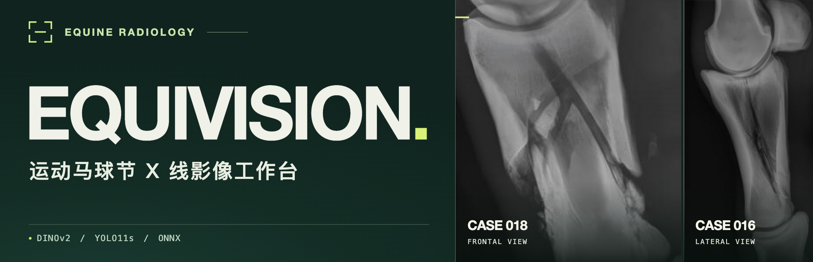
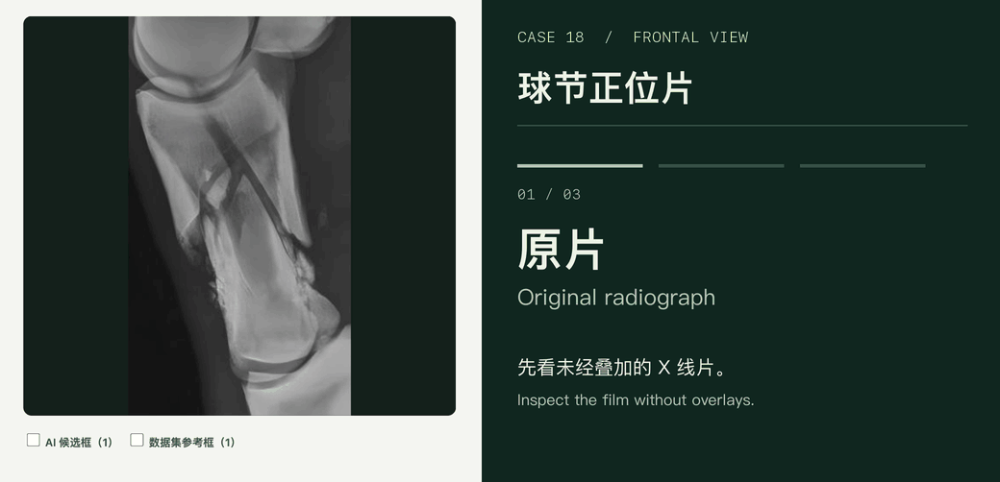

<h1><a href="https://elfaw775.github.io/sport-model/#new"></a></h1>

<a href="https://elfaw775.github.io/sport-model/#new"></a> <a href="https://elfaw775.github.io/sport-model/static/examples.html"></a>

[English](README.en.md)

用一张马球节 X 线片走完整个病例流程。**DINOv2** 提示整片是否可疑，**YOLO11s** 圈出候选位置，阅片人核对原片、补充标注，再签署报告。两个模型都可以在浏览器里运行。

**自己跑一次**　账号 `wangyiyi` · 密码 `wangyiyisportsHorse`。选 **16 号侧位片** → 确认影像质量 → 用此样片新建检查 → 开始分析。它会显示两个候选框。首次运行约下载 141 MB，可以先点“提前准备模型”。

## 跟着一张片读结果

**18 号 · 球节正位片**　切换图层，看看模型圈的位置和标注者留下的参考框是否重合。点击下图即可亲手切换，无需登录。

<a href="https://elfaw775.github.io/sport-model/static/examples.html#18">
  <picture>
    <source media="(prefers-reduced-motion: reduce)" srcset="docs/images/case-report-18.png">
    
  </picture>
</a>

[打开 18 号报告](https://elfaw775.github.io/sport-model/static/examples.html#18) · [查看静态截图](docs/images/case-report-18.png) · [对照 75 号报告](https://elfaw775.github.io/sport-model/static/examples.html#75)

**为什么还要看 75 号？** 这张片的整片筛查提示可疑，YOLO 却没有画框。打开参考图层，能看到数据集标出的两处病灶。阅片人可以据此对照原片，再决定是否补画病灶框。

## 模型在这批片上表现如何？

| 整片筛查 · DINOv2 | 误报框 · YOLO11s | 病灶命中 · YOLO11s |
| --- | --- | --- |
| **82 / 84 张判对** | **9 → 5 个** | **3 / 12 处** |
| 五折验证中，68 张阳性片漏 2 张，16 张阴性片均判对。 | 同一批 12 张留出片，重训后误报框减少 44.4%。 | 重训前后命中总数相同，框的命中率从 25.0% 升至 37.5%。 |

定位对照统一使用分数阈值 0.15、IoU ≥ 0.50。同批影像仅按图像高度也能判对 **81/84** 张，模型在新马匹和其他采集设备上的表现仍待验证。[逐片成绩](image-study/published/cv84/three-model-oof.csv) · [定位实验](training/results/comparison-2026-11-18/README.md)

<details>
<summary><strong>查看模型方法、阈值与评测口径</strong></summary>

**DINOv2 Small 做整片筛查。** 输入为补边至 336 × 336 的影像。冻结视觉编码器，用影像特征训练逻辑回归分类器，输出整片筛查分数。当前部署的分类头用全部 84 张片重新拟合。分数用于与筛查阈值比较，最终结论由阅片人复核。[筛查模型登记](backend/models/dinov2-fetlock-84.json) · [整片分类研究](image-study/README.zh-CN.md)

**YOLO11s 做病灶定位。** 原标注中有 66 个病灶框带旋转角度。修正转换脚本后，先按角度还原四角，再取水平外接框训练检测器。工作台按 640 × 640 输入推理，显示分数达到 0.20 的候选框。两种模型均导出为 ONNX，网页版使用 ONNX Runtime Web，Python 版使用 ONNX Runtime 在 CPU 上推理。[标签转换与训练记录](training/README.md) · [从样片到候选框的训练过程](training/results/yolo-family-2026-11-19/README.md)

五折成绩来自各折独立训练的模型。在相同五折划分下，原 YOLO11s 配方、修标重训 YOLO11s 和 DINOv2 分别漏掉 15、20 和 2 张阳性片。在线 YOLO 的显示阈值为 0.20，在历史留出片上命中 3 处、误报 2 框。[补边对照实验](image-study/published/cv84/canvas-round2/README.md)

</details>

## 使用与开发

<details>
<summary><strong>病例流程、标注导出与数据存储</strong></summary>

也可选 23、56、8 号体验片、从 84 张样片中随机抽一张，或上传自己的影像。23 号片会得到可疑的筛查提示和 0 个候选框，适合体验手动补标。

| 环节 | 工作台支持的操作 |
| --- | --- |
| 影像登记 | 上传 JPEG、PNG 或 WebP，为一次就诊关联多张影像，记录投照方向和质量。第一张为分析主图，其余影像用于对照。 |
| 阅片与标注 | 并排对照两张原片，缩放、平移、调亮度和对比度。两点量距离、三点量角度；未标定时距离按像素显示。可画矩形或四点四边形，保存人工标注。 |
| 复核与归档 | 保存草稿、签署并保留当时的报告、复核人和时间。复核意见留空需再次确认。历史记录支持搜索、筛选、编辑、补图和删除。 |
| 导出 | 下载可离线打开和打印的 HTML 报告。同一主图同时有 AI 框与人工框时，支持分别导出 AI、人工、合并三层的带框 PNG 或 CVAT COCO 1.0 数据包。 |

**数据存储**　公开版把原片、结果和病例放在当前浏览器的 IndexedDB。不同设备都能打开两份公开报告；跨设备共享新建病例需要连接同一 Python 服务和 SQLite 数据库。

</details>

<details>
<summary><strong>在本地运行 · Python 3.12</strong></summary>

使用 Python 3.12。在终端克隆项目、安装依赖并启动 FastAPI，即可用 CPU 运行随仓库提供的模型。

```bash
git clone https://github.com/elfaw775/sport-model.git
cd sport-model
python3.12 -m venv .venv
.venv/bin/python -m pip install -r backend/requirements.txt
.venv/bin/python -m uvicorn backend.app:app --host 127.0.0.1 --port 8765
```

Windows 可用 `py -3.12 -m venv .venv` 建环境，后两行的解释器改为 `.venv\Scripts\python.exe`。启动后打开[本地工作台](http://127.0.0.1:8765/)，可使用上方演示账号。默认数据库为 `var/cases.sqlite3`，包含原图、病例和复核记录。团队部署可通过 `SPORT_MODEL_DATA_DIR` 指向持久化目录，配置自有账号、HTTPS 和安全 Cookie 后供成员连接。[服务配置](backend/app.py)

</details>

<details>
<summary><strong>开发、验证、发布与许可</strong></summary>

- **修改工作台** [服务与病例接口](backend/) 使用 FastAPI 和 SQLite。[阅片界面](backend/static/)由 Python 版和 Pages 版共用；[浏览器端适配](backend/pages/)处理静态站点的本地存储和推理。
- **验证改动** 安装运行依赖后，执行 `.venv/bin/python -m pip install pytest httpx` 和 `.venv/bin/python -m pytest -q backend/tests`。执行 `.venv/bin/python scripts/build-example-reports.py --check` 可用仓库权重复算两份公开报告。安装 Node.js、pnpm 和 Chrome 后，可执行 `pnpm install --frozen-lockfile` 和 `node scripts/smoke-visits.mjs` 验证完整病例流程。[浏览器验收脚本](scripts/smoke-visits.mjs)
- **发布** 合入 `main` 后，GitHub Actions 打包工作台、模型、样片及[旧版 YOLO 工具](https://elfaw775.github.io/sport-model/legacy/)，并发布到 Pages。可从[部署工作流](.github/workflows/deploy.yml)查看构建命令。
- **参与项目** 欢迎通过 [Issues](https://github.com/elfaw775/sport-model/issues) 反馈。界面问题请附浏览器、操作步骤和示例片号；模型问题请注明整片判断或候选框、预期结果与实际结果。根目录尚未声明统一的项目许可证。第三方许可随组件提供，复用代码、权重或影像前请核对对应授权。[DINOv2 许可](backend/models/DINOv2-LICENSE.txt) · [ONNX Runtime 许可](backend/pages/ONNXRuntime-LICENSE.txt)

</details>

[反馈问题](https://github.com/elfaw775/sport-model/issues) · [English documentation](README.en.md)
