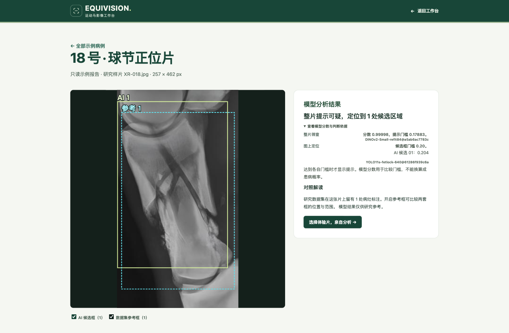

# EQUIVISION · 运动马球节 X 线影像工作台

[**在线试用工作台**](https://elfaw775.github.io/sport-model/#new) · [**免登录看示例报告**](https://elfaw775.github.io/sport-model/static/examples.html) · [English](README.en.md)

EQUIVISION 是一个面向运动马球节疑似骨折的影像研究项目。每次检查可上传多张 X 线片。DINOv2 对主图进行整片筛查，YOLO 在主图上标出可疑位置。阅片人可以对照原片、补画病灶框、签署报告并归档。公开工作台在浏览器里实际运行两个模型，有普通电脑和浏览器即可体验。

[](https://elfaw775.github.io/sport-model/static/examples.html#18)

## 先试一个病例

- **只想看结果** 打开 [18 号报告](https://elfaw775.github.io/sport-model/static/examples.html#18)，切换 AI 候选框和数据集参考框；再看 [75 号报告](https://elfaw775.github.io/sport-model/static/examples.html#75)。75 号片的整片筛查提示可疑，YOLO 给出 0 个框，参考标注有 2 处。两份报告均展示已保存的结果，打开即可看，无需登录或下载模型。
- **想亲自跑一遍** 进入 [新建检查](https://elfaw775.github.io/sport-model/#new)，使用演示账号 `wangyiyi` 和密码 `wangyiyisportsHorse` 登录。在上传区选择 **16 号侧位片**，核对体位及影像质量，然后用样片新建检查，点击“开始分析”。也可以选 23、56、8 号体验片，或从 84 张样片中随机抽取。首次运行约需下载 **141 MB** 模型与运行时，可先点“提前准备模型”。
- **想看医生如何复核** 16 号片在当前模型下显示 2 个候选框；23 号片筛查提示可疑、定位给出 0 框。两例均可查看原片、手动画框、填写复核意见、确认签署，再单独归档。回到“历史记录”即可按生成的 EV 编号找回病例。

**记录存在哪里？** GitHub Pages 版把原片、模型结果和病例存入当前浏览器的 IndexedDB。分享网址时，对方能看到两份公开示例，个人新建的记录留在原浏览器。团队共用病例可运行下方的 Python 版，连接同一服务的成员共用一份 SQLite 数据库。

## 从影像到报告

| 环节 | 工作台支持的操作 |
| --- | --- |
| 影像登记 | 上传 JPEG、PNG 或 WebP，为一次就诊关联多张影像，记录投照方向和质量。第一张为分析主图，其余影像用于对照。 |
| 阅片与标注 | 并排对照两张原片，缩放、平移、调亮度和对比度。两点量距离、三点量角度；未标定时距离按像素显示。可画矩形或四点四边形，保存人工标注。 |
| 复核与归档 | 保存草稿、签署并保留当时的报告、复核人和时间。复核意见留空需再次确认。历史记录支持搜索、筛选、编辑、补图和删除。 |
| 导出 | 下载可离线打开和打印的 HTML 报告。同一主图同时有 AI 框与人工框时，支持分别导出 AI、人工、合并三层的带框 PNG 或 CVAT COCO 1.0 数据包。 |

## 两个模型怎样配合

**DINOv2 Small 做整片筛查。** 输入为补边至 336 × 336 的影像。冻结视觉编码器，用影像特征训练逻辑回归分类器，输出整片筛查分数。当前部署的分类头用全部 84 张片重新拟合。分数用于与筛查阈值比较，最终结论由阅片人复核。[筛查模型登记](backend/models/dinov2-fetlock-84.json) · [整片分类研究](image-study/README.zh-CN.md)

**YOLO11s 做病灶定位。** 原标注中有 66 个病灶框带旋转角度。修正转换脚本后，先按角度还原四角，再取水平外接框训练检测器。工作台按 640 × 640 输入推理，显示分数达到 0.20 的候选框。两种模型均导出为 ONNX，网页版使用 ONNX Runtime Web，Python 版使用 ONNX Runtime 在 CPU 上推理。[标签转换与训练记录](training/README.md) · [从样片到候选框的训练过程](training/results/yolo-family-2026-11-19/README.md)

## 目前效果如何

项目数据含 **84 张球节 X 线片，68 张阳性、16 张阴性，共 81 处标注病灶**。整片筛查按片计分，定位按框计分。

| 评测问题 | 内部评测结果 |
| --- | --- |
| 哪些阳性片会漏掉？ | 在相同的五折划分下，每张片只作一次测试。68 张阳性片中，原 YOLO11s 配方漏 15 张，修标重训配方漏 20 张，DINOv2 漏 2 张。DINOv2 对 16 张阴性片均判对，合计 **82/84**。 |
| 修标重训减少了多少误报框？ | 在同一批 12 张历史留出片上，固定分数阈值 0.15、交并比（IoU）≥ 0.50。YOLO11s 重训前后均命中 **3/12** 处病灶，误报框 **9 → 5**，减少 **44.4%**；提示框命中率 **25.0% → 37.5%**。工作台实际阈值为 0.20，重训版在同批片上命中 3 处、误报 2 框。 |

仅按图像高度分类也能判对 **81/84** 张，这提示采集或导出方式可能影响内部评测。工作台适用于研究演示和人工复核；能否在来自新马匹和其他设备的影像上稳定发现骨折，仍需独立验证。[五折逐片预测](image-study/published/cv84/three-model-oof.csv) · [定位命中与误报明细](training/results/comparison-2026-11-18/README.md) · [补边对照实验](image-study/published/cv84/canvas-round2/README.md)

## 本地运行

使用 Python 3.12。在终端克隆项目、安装依赖并启动 FastAPI，即可用 CPU 运行随仓库提供的模型。

```bash
git clone https://github.com/elfaw775/sport-model.git
cd sport-model
python3.12 -m venv .venv
.venv/bin/python -m pip install -r backend/requirements.txt
.venv/bin/python -m uvicorn backend.app:app --host 127.0.0.1 --port 8765
```

Windows 可用 `py -3.12 -m venv .venv` 建环境，后两行的解释器改为 `.venv\Scripts\python.exe`。启动后打开[本地工作台](http://127.0.0.1:8765/)，可使用上方演示账号。默认数据库为 `var/cases.sqlite3`，包含原图、病例和复核记录。团队部署可通过 `SPORT_MODEL_DATA_DIR` 指向持久化目录，配置自有账号、HTTPS 和安全 Cookie 后供成员连接。[服务配置](backend/app.py)

## 开发、验证与反馈

- **修改工作台** [服务与病例接口](backend/) 使用 FastAPI 和 SQLite。[阅片界面](backend/static/)由 Python 版和 Pages 版共用；[浏览器端适配](backend/pages/)处理静态站点的本地存储和推理。
- **验证改动** 安装运行依赖后，执行 `.venv/bin/python -m pip install pytest httpx` 和 `.venv/bin/python -m pytest -q backend/tests`。执行 `.venv/bin/python scripts/build-example-reports.py --check` 可用仓库权重复算两份公开报告。安装 Node.js、pnpm 和 Chrome 后，可执行 `pnpm install --frozen-lockfile` 和 `node scripts/smoke-visits.mjs` 验证完整病例流程。[浏览器验收脚本](scripts/smoke-visits.mjs)
- **发布** 合入 `main` 后，GitHub Actions 打包工作台、模型、样片及[旧版 YOLO 工具](https://elfaw775.github.io/sport-model/legacy/)，并发布到 Pages。可从[部署工作流](.github/workflows/deploy.yml)查看构建命令。
- **参与项目** 欢迎通过 [Issues](https://github.com/elfaw775/sport-model/issues) 反馈。界面问题请附浏览器、操作步骤和示例片号；模型问题请注明整片判断或候选框、预期结果与实际结果。根目录尚未声明统一的项目许可证。第三方许可随组件提供，复用代码、权重或影像前请核对对应授权。[DINOv2 许可](backend/models/DINOv2-LICENSE.txt) · [ONNX Runtime 许可](backend/pages/ONNXRuntime-LICENSE.txt)
