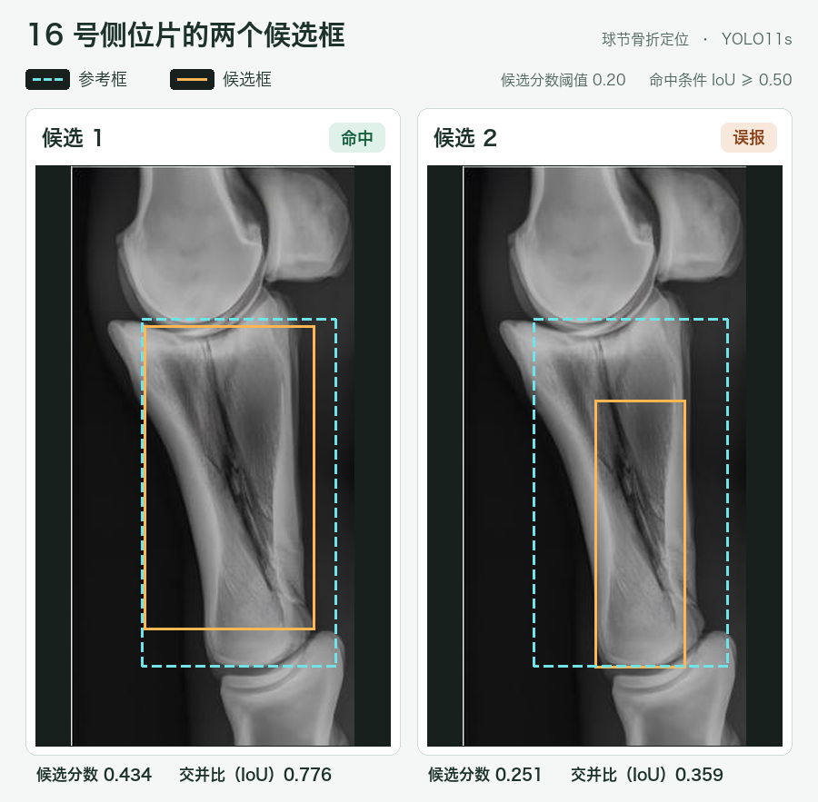

# 从 84 张马片到工作台中的病灶框

Python 工作台使用校正旋转框后重训的 YOLO11s，输入 640 × 640，候选阈值 0.20。该模型在 12 张历史留出片上命中 3 个标注病灶，误报 2 框，漏掉 9 处。保留每个病例原先记录的模型版本和阈值。[ONNX 推理权重](../../../backend/models/yolo11s-fetlock-640.onnx) · [PyTorch 训练权重](../comparison-2026-11-18/yolo11s-epoch12.pt)

## 1. 先明确让模型学什么

任务是给一张完整的马球节 X 线片，让模型框出疑似骨折的位置。训练时，参考框告诉模型该看哪里。读新片时，模型只能看到影像。现有数据只支持这一类定位任务。报告中的分数用来排列候选框。若要把分数解释成患病概率，还需要以马匹为单位单独校准和验证。

84 张片中有 68 张标有病灶，16 张标为正常。原标注共有 81 处病灶，其中 66 个矩形带旋转角度。旧转换器忽略了角度，导致斜框的水平边界和标注者圈定的范围不一致。修正时先还原四个角的位置，再取能包住四角的水平框，裁到图像边界。训练、验证、历史留出分别有 57、12、12 个病灶。[原始标注](../../source/coco/instances_default.json) · [转换器与逐框示例](../../README.md#标签转换版本2026-11-18)

沿用项目给定的逐片独立假设。84 张片的解码后灰度像素各不相同，但文件名前缀只有 70 个，编号 1、10、17、18 均在训练和验证两组出现。仓库缺少可核验的马匹身份对应表，不能据此证实跨组马匹独立。[固定划分清单](../../data/sporthorse_v2/split_manifest.tsv)

## 2. 怎样判断一个框有没有用

以留出的 16 号侧位片为例。这张片有一处标注，当前模型画出两个框。第一个分数 0.434，框与标注的交并比为 0.776，计一次命中。第二个分数 0.251，交并比只有 0.359，计一次误报。交并比是两个框重叠的面积除以它们覆盖的总面积，达到 0.50 才计命中。每处标注最多配给一个框。[打开这张原片](../../data/sporthorse_v2/images/test/16-侧位.jpg) · [逐片预测](../comparison-2026-11-18/predictions.zip)



## 3. 先定阈值，再比较模型

59 张用于训练，13 张用于选择框的显示阈值，12 张用于历史留出回归。后两组各有 12 个参考病灶。我们把平均每张验证片最多一个误报框作为预算，在预算内选命中最多的阈值。如果命中一样多，选误报更少的，再以较低阈值打破平局。最后锁定阈值，在历史留出片上统计命中、误报和漏检。

| YOLO 模型 | 验证选择阈值 | 验证命中 / 12 | 验证误报框 | 留出命中 / 12 | 留出误报框 |
| --- | ---: | ---: | ---: | ---: | ---: |
| 修标 YOLO11s，标准 AdamW，当前版本 | 0.20 | 5 | 6 | 3 | 2 |
| 同一 YOLO11s，精细定位层学习率 × 1.5 | 0.25 | 6 | 11 | 3 | 5 |
| YOLO11s，同样的初始化，延长到 36 轮 | 0.075 | 5 | 6 | 1 | 6 |
| 更大的 YOLO11m | 0.075 | 4 | 12 | 1 | 6 |
| 新架构 YOLO26s | 0.075 | 7 | 11 | 3 | 13 |
| YOLO26s，从人类腕片迁移后在马片上训练 | 0.10 | 3 | 4 | 2 | 8 |
| Hugging Face 骨折 ONNX，直接读片 | 0.15 | 0 | 0 | 0 | 3 |

COCO 初始化的 YOLO26s 在验证片多找到了两处，优势在留出片上消失。切换到固定阈值 0.15 后，YOLO26s 在留出片上命中 0 处、误报 5 框，修标 YOLO11s 在同阈值命中 3 处、误报 5 框。工作台选用修标 YOLO11s 的依据是病灶定位与误报负担。这一小规模单种子对照不足以估算新病例上的诊断准确率。[完整计数、阈值和权重哈希](metrics.json) · [逐片预测、运行记录和训练曲线](runs.zip)

本轮对两个新候选使用相同的替换条件。与当前模型相比，验证集至少要保住 5 个命中、至多 6 个误报，其中一项还要改善。通过后，再核对历史留出集能否保持至少 3 个命中、至多 2 个误报。历史留出已反复用于回归，因此这个门槛只能用于本项目版本决策。

## 4. 选模型、训练，以及走过的弯路

三个通用检测基线 YOLO11s、11m 和 26s 从各自的官方 COCO 权重起步，训练 12 轮、输入 640、batch 4、seed 42、冻结前 10 层，使用相同的几何增强，取最后一轮权重。精细定位实验保留原有 AdamW，仅将最高分辨率检测层的框回归参数分组，使其学习率目标从 0.001 提至 0.0015。分类、其余尺度、权重衰减和各组预热规则沿用原方案。它在验证片增加一个命中，在留出片没有增加命中，误报增加 3 框。[训练入口](../../scripts/train_yolo_comparison.py) · [优化器实现](../../scripts/fetlock_optimizer.py)

修标训练使用的官方 YOLO11s 初始化文件，其 SHA-256 与 Hugging Face 固定版本一致，项目此前的复现说明给出的下载源是 Ultralytics GitHub Release。项目训练指南另引用了 Jesteban247 的人类骨折模型作为冻结层数的参考。该仓库提供 YOLO11n 单类骨折 ONNX，本轮将这份权重直接应用于马片，未对它进行微调。[原项目训练指南](../../docs/训练指南.md) · [YOLO11 官方权重](https://huggingface.co/Ultralytics/YOLO11/tree/8b8ac7d1fae7468f85dbf89670dd66f41f485aab) · [YOLO26 官方权重](https://huggingface.co/Ultralytics/YOLO26/tree/070ac3c51435984d992ba92eb3f234daf4e4500d) · [骨折模型源文件](https://huggingface.co/Jesteban247/yolo11-fracture-onnx/blob/8227dbcdcf80f3cd06f052a8295ee42657989deb/best.onnx)

**延长训练。** 从相同的官方 YOLO11s 初始化独立训练 36 轮，使用与 12 轮实验相同的 59 张训练片、冻结层数、batch 和增强。学习率随训练总轮数衰减。总轮数从 12 增至 36 后，验证集仍为 5 个命中、6 个误报，历史留出降为 1 个命中、6 个误报。这次没有观察到延长训练带来的定位收益。

**从 Hugging Face 找能继续训练的 X 线模型。** 为检验“先学过骨折影像是否有帮助”，选了 GRAZPEDWRI 人体腕部骨折 YOLO26s。这份 PyTorch 检查点包含训练参数。下载时固定仓库版本并校验 SHA-256。上游目录名为第 100 轮，内部记录显示其中的最佳权重来自第 55 轮。迁移时载入 552 项特征提取与位置回归参数或缓冲区，两个分类分支沿用原对照的初始化流程，在马片上训练单一病灶类。训练使用 MPS，12 轮耗时约 65 秒。[腕片权重固定版本](https://huggingface.co/Crimson-Dawn/grazpedwri-yolo26-checkpoints/tree/01213afe2b4e978585339b3a0d5c6e23b38d538b) · [腕片数据集论文](https://www.nature.com/articles/s41597-022-01328-z) · [权重导入代码](../../scripts/wrist_initialization.py)

与同架构 COCO 初始化相比，腕片迁移在历史留出集把误报从 13 框减到 8 框，命中也从 3 处减到 2 处。把两个新候选的命中逐个与当前工作台对齐，在 25 张评估片上，两个候选都没找回当前版本漏掉的病灶。腕片模型还漏掉了当前版本能找到的 61 号病灶。两次实验的来源、实际参数、逐片框和训练曲线已归档，未采用的临时权重在归档校验后清理。[61 号原片](../../data/sporthorse_v2/images/test/61-LF-正位+斜位.jpg) · [逐片实验包](runs.zip)

**换到 RTX 4070 Laptop。** 协作者在同一划分上训练了 32 轮。RF-DETR Small 在验证片命中 8 处，在留出片命中 1 处、误报 4 框。同机 YOLO11s 在留出片命中 2 处、误报 8 框。CUDA 可以跑不同的实验配方，这组结果没有显示换机器就能提高检出。两台机器的训练轮数、精度和权重选择方式不同，不能用它们衡量硬件对准确率的影响。[协作者的训练记录与 AP 指标](../comparison-2026-11-19-rfdetr/README.md)

**为什么没有继续调低阈值。** 对当前 YOLO11s，在历史留出集把门槛从 0.15 降到 0.01，命中仍是 3 处，误报从 5 框增加到 47 框。9 处漏检里，3 处只有位置不准的候选，另外 6 处没有任何覆盖病灶的候选。数据固定时，可以从这批错例理解模型的局限。要估计在新马匹上的表现，需要另行盲评。[逐病灶错例分析](../comparison-2026-11-18/README.md#漏检发生在哪里)

## 5. 把训练权重接到工作台，再复算

发布权重从归档的第 12 轮 PyTorch 权重导出，CPU、FP32、ONNX opset 17、静态 batch 1、无内置 NMS。Python 服务对 25 张验证和留出影像逐张推理。0.20 阈值下的 16 个候选与训练端逐一对应，最大坐标差低于 0.00006 像素，最大分数差低于 0.000002。后端回归测试比较全部 25 张，浏览器验收覆盖有框、无框、人工复核和归档。[回归测试](../../../backend/tests/test_detector.py)

在仓库根目录运行 `python training/scripts/prepare_comparison.py` 准备数据。以下命令使用已有的 Python 3.12 训练环境和重新下载的预训练文件。Mac 实验使用 PyTorch 2.15.0、Ultralytics 8.4.215 和 MPS，运行参数随预测一起归档。[安装命令](../comparison-2026-11-18/README.md#权重和复现) · [权重校验值](metrics.json)

```sh
python training/scripts/train_yolo_comparison.py --weights work/model-comparison/pretrained/yolo11s.pt --epochs 12 --output work/model-comparison/repro-release
python training/scripts/train_yolo_comparison.py --weights work/model-comparison/pretrained/yolo11s.pt --epochs 36 --output work/model-comparison/repro-36epochs
python training/scripts/train_yolo_comparison.py --weights work/model-comparison/pretrained/yolo11s.pt --optimizer-profile fetlock-box --output work/model-comparison/repro-fetlock-box
python training/scripts/train_yolo_comparison.py --weights work/model-comparison/yolo-family/pretrained/yolo26s.pt --output work/model-comparison/repro-yolo26s
python training/scripts/train_yolo_comparison.py --weights work/model-comparison/yolo-family/pretrained/yolo11m.pt --output work/model-comparison/repro-yolo11m
python training/scripts/compare_detectors.py --candidate work/model-comparison/repro-yolo26s
```

只想核对结果时，先准备上述数据，再解压实验包，将含有两份逐片预测的目录传给 `compare_detectors.py --candidate` 复算，无需重训。复测单类 ONNX 使用后端环境中的 `training/scripts/evaluate_yolo_onnx.py --model 文件 --sha256 校验值 --output 新目录`。

要重训腕片迁移候选，可用下列命令下载本实验的两个固定输入。训练入口自动校验两个文件的 SHA-256。

```sh
mkdir -p work/model-comparison/pretrained
curl -fL --retry 3 'https://huggingface.co/Ultralytics/YOLO26/resolve/070ac3c51435984d992ba92eb3f234daf4e4500d/yolo26s.pt' -o work/model-comparison/pretrained/yolo26s.pt
curl -fL --retry 3 'https://huggingface.co/Crimson-Dawn/grazpedwri-yolo26-checkpoints/resolve/01213afe2b4e978585339b3a0d5c6e23b38d538b/runs/baseline_yolo26s_640_100epochs_seed42_from50_20260917_163013_311680Z/epoch_100/best.pt' -o work/model-comparison/pretrained/grazpedwri-yolo26s.pt
python training/scripts/train_yolo_comparison.py --weights work/model-comparison/pretrained/yolo26s.pt --wrist-checkpoint work/model-comparison/pretrained/grazpedwri-yolo26s.pt --output work/model-comparison/repro-wrist
python training/scripts/compare_detectors.py --candidate work/model-comparison/repro-wrist
```
